<!-- ═══════════════════════════════════════════════════════════════════════════
     ADITYA RASAL — GitHub Profile README
     Design: Apple-inspired · Monochrome + Blue Accent · Premium Typography
     ═══════════════════════════════════════════════════════════════════════════ -->

<!-- ─── ANIMATED HEADER ─── -->

<!-- ─── TYPING EFFECT ─── -->
 

 

<!-- ─── QUICK LINKS ─── -->

  
  &nbsp;
  
  &nbsp;
  
  &nbsp;
  

 

<!-- ═══════════════════════════════════════════════════════════════════════════ -->

 

## &nbsp;&nbsp;`01` &nbsp; About

> **AI Engineer** specializing in Computer Vision, with hands-on experience designing,
> training, and deploying production ML pipelines end-to-end — from model development
> to full-stack deployment tooling and internal vision platforms.

I combine deep technical delivery with project management practice: leading cross-functional
teams of **150+**, owning budgets and timelines, and applying **Agile/Scrum** across
concurrent initiatives.

<table>
<tr>
<td width="50%">

**🎓 &nbsp; Education**

Bachelor of Computer Science Engineering & Technology
**Pimpri-Chinchwad University**, Pune
CGPA **9.1 / 10** · Graduating 2027

</td>
<td width="50%">

**📍 &nbsp; Location**

Pune, Maharashtra, India

**🏅 &nbsp; Certifications**

Google Project Management · IBM Machine Learning
Agile with Atlassian Jira

</td>
</tr>
</table>

 

 

## &nbsp;&nbsp;`02` &nbsp; Tech Stack

<!-- ─── LANGUAGES ─── -->

**Languages**

 

<!-- ─── AI / ML / CV ─── -->

**AI Engineering & Computer Vision**

 

<!-- ─── GENERATIVE AI ─── -->

**Generative AI & LLMs**

 

<!-- ─── FULL STACK ─── -->

**Full-Stack Development**

 

<!-- ─── PROJECT MANAGEMENT ─── -->

**Project Management**

 

 

## &nbsp;&nbsp;`03` &nbsp; Featured Projects

 

<table>
<tr>
<td width="50%" valign="top">

### 🔬 &nbsp; Vision Studio

**Offline Computer Vision Model Studio**

Python · FastAPI · PyTorch · Ultralytics YOLO · OpenCV · PyWebView

  

A fully offline desktop platform for the **end-to-end CV model lifecycle** —
dataset creation, annotation, and GPU-accelerated training with zero cloud dependency.

 

**Key Capabilities:**

- Multi-task annotation engine — **Detection**, **SAM-assisted Segmentation**, **Classification**
- Automated frame extraction from **RTSP/USB** feeds
- One-click model export to **TorchScript** and **OpenVINO**
- Built for researchers and operators who need full control without cloud costs

 

</td>
<td width="50%" valign="top">

### ⚡ &nbsp; Vision Flow

**Edge AI Live Detection & Monitoring Platform**

Python · FastAPI · PyTorch · YOLOv8/YOLO11/YOLO26 · OpenCV · SQLite · SSE · ReportLab

  

A production edge-AI inference system for **real-time plant and perimeter monitoring**
handling concurrent multi-camera streams.

 

**Key Capabilities:**

- **Concurrent USB, RTSP, and QR-paired mobile** camera streams
- ~45 ms average inference latency *(per resume)*
- **Active-learning feedback loop** that routes false detections back into training data
- Auto-generated **tamper-evident PDF compliance reports**
- ~20% accuracy improvement over time through continuous retraining

 

</td>
</tr>
</table>

 

> [!NOTE]
> The ~45 ms latency and ~20% accuracy improvement figures are sourced from the project descriptions on Aditya's resume.
> They have not been independently benchmarked in this README — treat them as self-reported development metrics.

 

 

## &nbsp;&nbsp;`04` &nbsp; Leadership & Impact

<table>
<tr>
<td width="60px" align="center">👑</td>
<td>

**Cultural President** — Student Council, Pimpri-Chinchwad University
 
Aug 2026 – Present
  
Directing a **150+ member** student volunteer workforce across major campus initiatives
(IDEATHON 2.0, Pitch Fest), consistently delivering **under budget**.

</td>
</tr>
<tr>
<td width="60px" align="center">🎪</td>
<td>

**Event Lead** — Anantam Cultural Festival
 
Jan 2024 – Jan 2026 · 3 Editions
  
Led a 2-day university festival across **3 consecutive editions**, managing **200+ team members**
and coordinating budget, timelines, and vendor/stakeholder relationships for **6,000+ attendees**
with 100% on-time delivery.

</td>
</tr>
</table>

 

 

## &nbsp;&nbsp;`05` &nbsp; GitHub Analytics

 

&nbsp;&nbsp;

  

  

<!-- Contribution Graph -->

 

 

## &nbsp;&nbsp;`06` &nbsp; Certifications

&nbsp;

&nbsp;

 

 

<!-- ─── CONNECT ─── -->

### Let's Connect

 

&nbsp;&nbsp;

&nbsp;&nbsp;

  

<!-- ─── FOOTER ─── -->

<!-- ═══════════════════════════════════════════════════════════════════════════
     END OF README
     ═══════════════════════════════════════════════════════════════════════════ -->

