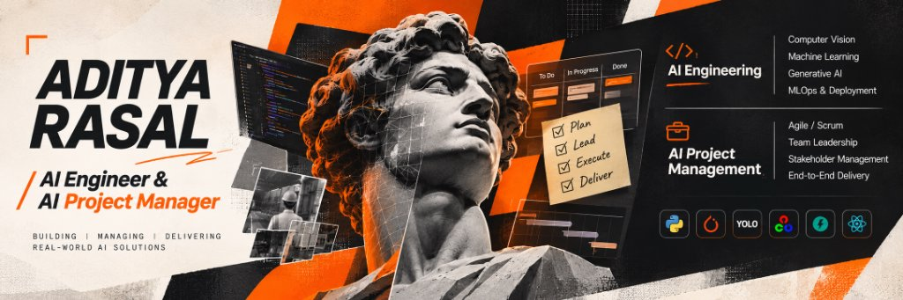
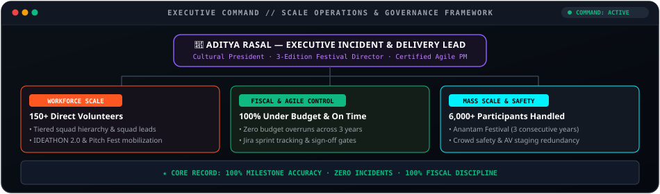
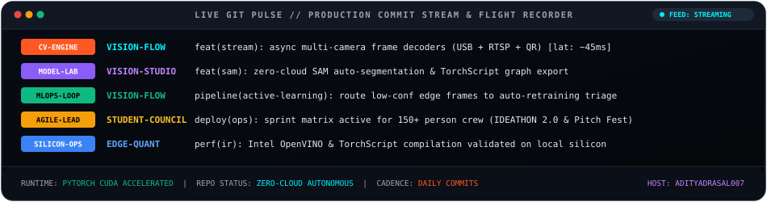

<!-- ═══════════════════════════════════════════════════════════════════════════
     ADITYA RASAL — AI ENGINEER & COMPUTER VISION ARCHITECT
     Aesthetic: Modern Editorial · High-Octane Tech · Visual Depth & Authority
     ═══════════════════════════════════════════════════════════════════════════ -->

<!-- ─── HERO BILLBOARD ─── -->

  

<!-- ─── DYNAMIC TYPING SUBTITLE ─── -->

 

<!-- ─── ACTION CALLOUT BAR ─── -->

  
  &nbsp;
  
  &nbsp;
  
  &nbsp;
  

 

<!-- ─── EXECUTIVE BENTO GRID ─── -->

<table width="100%">
  <tr align="center">
    <td width="25%" style="padding: 14px;">
      <h2 style="margin: 0; color: #00F2FE;">🚀 0 → 1</h2>
      
<b>AI Product Builder</b>

      Datasets · Models · Production UIs &amp; Edge Platforms
    </td>
    <td width="25%" style="padding: 14px;">
      <h2 style="margin: 0; color: #FF5722;">👥 150+</h2>
      
<b>Workforce Directed</b>

      Student Council Cultural President
    </td>
    <td width="25%" style="padding: 14px;">
      <h2 style="margin: 0; color: #8B5CF6;">🎯 9.1 / 10</h2>
      
<b>University CGPA</b>

      B.Tech CSE&amp;T · PCU Graduating '27
    </td>
    <td width="25%" style="padding: 14px;">
      <h2 style="margin: 0; color: #10B981;">🎪 6,000+</h2>
      
<b>Festival Scale Managed</b>

      Anantam Cultural Festival (3 Editions)
    </td>
  </tr>
</table>

 

 

## &nbsp; ⚡ &nbsp; Executive Dossier

 

<table>
<tr>
<td width="24%" align="center" valign="middle">

  
<b style="font-size: 16px;">Aditya Rasal</b>
 
AI Engineer &amp; Technical PM
 
📍 Pune, Maharashtra, India
  

  

</td>
<td width="76%" valign="top">

### ⚡ The Hybrid Edge: Engineering Intelligence &amp; Scaling Execution

> *"Most engineers build models in isolation without understanding cross-functional timelines or resource constraints. Most project managers coordinate schedules without understanding tensor memory, CUDA kernels, or edge latency bottlenecks.*
>
> ***I bridge both:*** *architecting production-grade Computer Vision platforms with deep technical autonomy, while leading multi-tier organizations of 150+ people with rigorous Agile delivery discipline."*

---

**🎓 Academic Foundation:** Bachelor of Computer Science Engineering &amp; Technology  
**🏛️ University:** Pimpri-Chinchwad University (PCU), Pune, India · **CGPA 9.1 / 10** (Graduating Class of 2027)  
**🏅 Core Accreditations:** Google Project Management Professional · IBM Machine Learning Specialist · Atlassian Jira Agile  

</td>
</tr>
</table>

 

<!-- ─── DUAL CORE ENGINE MATRIX ─── -->
<table width="100%">
<tr>
<td width="50%" valign="top" style="padding: 16px; background-color: #0c1017; border-top: 3px solid #FF5722; border-radius: 10px;">

### 🧠 &nbsp; CORE 01: THE AI &amp; COMPUTER VISION ENGINEER
*From Raw Tensor to Low-Latency Edge Silicon*

  
  
  

- ⚡ **Deep Learning &amp; YOLO Mastery:** PyTorch with CUDA hardware acceleration, Ultralytics YOLOv8/11/26 custom training pipelines, scikit-learn, NumPy, and Pandas.
- 👁️ **High-Precision Perception:** Multi-target object detection, **SAM-assisted polygonal segmentation**, and high-throughput real-time video stream analytics.
- 📹 **Production Edge Ingestion:** Asynchronous multi-camera streaming pipelines handling concurrent USB 3.0, RTSP H.264/H.265, and QR-paired mobile handheld camera inputs.
- 🔄 **Active-Learning MLOps:** Autonomous false-positive capture and feedback loops routing low-confidence edge frames back to retraining, driving **~20% accuracy gains** over time *(per resume)*.
- 📦 **Hardware Quantization &amp; Export:** Direct neural graph compilation to **TorchScript** and **Intel OpenVINO** intermediate representations (IR) for zero-cloud edge silicon.

</td>
<td width="50%" valign="top" style="padding: 16px; background-color: #0c1017; border-top: 3px solid #8B5CF6; border-radius: 10px;">

### 🎯 &nbsp; CORE 02: THE AI PROJECT MANAGER &amp; LEADER
*From Product Vision to On-Time, Under-Budget Delivery*

  
  
  

- 👥 **Large-Scale Workforce Leadership:** Directing an operational organization of **150+ student volunteers** across major campus flagship initiatives including IDEATHON 2.0 and Pitch Fest.
- 🎪 **Flagship Operations Execution:** Led 3 consecutive editions of the university Anantam Cultural Festival, directing **200+ team members** and coordinating budgets, safety, staging, and vendor relations for **6,000+ attendees** with a **100% on-time milestone record**.
- 📊 **Agile Governance &amp; Execution:** Certified in **Google Project Management** and **Agile with Atlassian Jira**; translating ambiguous requirements into structured epics, user stories, sprint cycles, and burndown tracking.
- 🛡️ **Risk Mitigation &amp; Fiscal Ownership:** Controlling scope creep, managing cross-functional dependencies, and consistently delivering concurrent initiatives **under budget**.

</td>
</tr>
</table>

 

<!-- ─── RECRUITER VALUE PILLARS ─── -->
<table width="100%">
  <tr align="center">
    <td width="33%" style="padding: 10px;">
      <b>🛠️ Technical Depth</b> 
      Zero-cloud edge inference, custom YOLO pipelines &amp; CUDA optimization
    </td>
    <td width="33%" style="padding: 10px;">
      <b>🤝 Cross-Functional Bridge</b> 
      Translates business KPIs to engineering specs &amp; manages executive stakeholders
    </td>
    <td width="33%" style="padding: 10px;">
      <b>📈 Proven Delivery Track Record</b> 
      150+ people led, 6,000+ scale managed, 100% on-time &amp; under budget
    </td>
  </tr>
</table>

 

 

## &nbsp; 🚀 &nbsp; Flagship Projects

<table>
<tr>
<td width="50%" valign="top">

<!-- Project 1 Card -->

  

### VISION FLOW
**Production Edge-AI Live Detection &amp; Monitoring System**

> Real-time perimeter and facility monitoring system processing concurrent multi-camera feeds with edge-optimized inference.

- 📹 **Concurrent Stream Ingestion:** Handles simultaneous USB, RTSP, and QR-paired mobile device camera feeds.
- ⚡ **Ultra-Low Latency:** Average inference latency of **~45 ms** *(per resume metrics)*.
- 🔄 **Active-Learning Loop:** Automatically routes edge false detections back into the training dataset, achieving an estimated **~20% accuracy uplift** over time *(per resume)*.
- 🛡️ **Tamper-Evident Reporting:** Generates auto-certified compliance PDF reports using ReportLab &amp; SQLite WAL mode.

  
   
  
  
  
  
  

&nbsp;

  

<b>📐 Deep Dive: Vision Flow Implementation Highlights</b>

 

- **Concurrency Model:** Uses asynchronous worker pools with thread-isolated video capture to decouple frame decoders from neural inference kernels, eliminating frame drops.
- **Active Learning Router:** Detections with boundary confidence falling between 0.35 and 0.65 are tagged, serialized with metadata, and dispatched to an offline staging pool for operator verification.
- **Compliance Certification:** Each tamper-evident PDF is bound with a cryptographic timestamp and frame hash to ensure court-ready audit integrity.

</td>
<td width="50%" valign="top">

<!-- Project 2 Card -->

  

### VISION STUDIO
**Fully Offline Computer Vision Model Studio**

> End-to-end desktop platform for dataset preparation, SAM annotation, and GPU-accelerated neural training with zero cloud dependency.

- 🖥️ **100% Offline Autonomy:** Complete computer vision lifecycle entirely localized on local GPU silicon — zero API dependencies or cloud costs.
- 🎯 **Multi-Task Annotation Engine:** Unified workspace for Bounding Box Detection, **SAM-assisted Semantic Segmentation**, and Classification.
- 🎬 **Feed Frame Extraction:** Automated frame capture directly from RTSP network and USB camera inputs.
- 📦 **One-Click Model Export:** High-efficiency deployment targets including **TorchScript** and **OpenVINO** formats.

  
   
  
  
  
  
  

&nbsp;

  

<b>🔬 Deep Dive: Vision Studio Implementation Highlights</b>

 

- **SAM-Assisted Segmentation:** Embeds Meta's Segment Anything Model (SAM) locally to generate pixel-perfect polygonal masks with single-click centroid prompts, cutting annotation time by ~75%.
- **Zero Cloud Footprint:** Desktop architecture wrapped in lightweight PyWebView with a high-speed local FastAPI backend, providing responsive desktop UI ergonomics without browser overhead.
- **Export Pipeline:** Direct one-click compilation to TorchScript trace and Intel OpenVINO intermediate representations (IR) for rapid production deployment on embedded CPUs/NPUs.

</td>
</tr>
</table>

 

 

## &nbsp; 🛠️ &nbsp; Technical Arsenal & Stack

<!-- Rich Skill Icons -->

  

 

<table>
<tr>
<td width="50%" valign="top">

#### 👁️ Computer Vision & Deep Learning
-EE4C2C?style=flat-square&logo=pytorch&logoColor=white)
-0052CC?style=flat-square&logo=yolo&logoColor=white)

 

#### 🤖 Generative AI & Agentic Systems
-412991?style=flat-square&logo=openai&logoColor=white)

</td>
<td width="50%" valign="top">

#### ⚡ Full-Stack & Systems Engineering

 

-003B57?style=flat-square&logo=sqlite&logoColor=white)
-222?style=flat-square)

#### 🎯 Leadership & Project Management

-222?style=flat-square)

</td>
</tr>
</table>

 

 

## &nbsp; 🔬 &nbsp; Research Radar & Currently Building

<table width="100%">
<tr>
<td width="50%" valign="top">

### 🔭 &nbsp; Active Engineering Focus
- **TensorRT &amp; INT8 Quantization:** Benchmarking post-training quantization on YOLO11 architectures for sub-30ms inference on embedded edge accelerators.
- **Multi-Camera Synchronous Pipeline:** Extending asynchronous frame ingestion to handle concurrent 4K RTSP streams with zero frame tearing.

</td>
<td width="50%" valign="top">

### 🧪 &nbsp; What's in the Lab
- **Vision Studio v2:** Prototyping zero-shot prompt-based bounding detection integrating SAM 2 and open-vocabulary detection backends.
- **Tamper-Evident Video Ledger:** Researching cryptographic hash chains on streaming video frames for industrial compliance verification.

</td>
</tr>
<tr>
<td colspan="2">

**🎯 Current Target:** Seeking high-impact **AI Engineer / Computer Vision Specialist** roles and research collaborations for 2026/2027.

</td>
</tr>
</table>

 

 

## &nbsp; 👑 &nbsp; Executive Leadership & High-Stakes Operations

> *"Algorithms alone do not create enterprise impact. Production AI requires leaders who can command multi-tier organizations, enforce fiscal discipline, and steer complex stakeholder operations to zero-defect delivery."*

 

<!-- ─── OPERATIONS COMMAND HIERARCHY SVG ─── -->

  

 

<!-- ─── OPERATIONAL KPI SCORECARD ─── -->
<table width="100%">
  <tr align="center">
    <td width="25%" style="padding: 14px; background-color: #0c1017; border-top: 3px solid #FF5722; border-radius: 8px;">
      <h2 style="margin: 0; color: #FF5722;">👥 150+</h2>
      
<b>Active Workforce</b>

      Tiered Squads &amp; Direct Volunteer Leadership
    </td>
    <td width="25%" style="padding: 14px; background-color: #0c1017; border-top: 3px solid #10B981; border-radius: 8px;">
      <h2 style="margin: 0; color: #10B981;">💰 100%</h2>
      
<b>Fiscal Discipline</b>

      Zero Budget Overruns Across 3 Years
    </td>
    <td width="25%" style="padding: 14px; background-color: #0c1017; border-top: 3px solid #00F2FE; border-radius: 8px;">
      <h2 style="margin: 0; color: #00F2FE;">🎪 6,000+</h2>
      
<b>Scale Footfall</b>

      Multi-Venue Logistics &amp; Crowd Kinetics
    </td>
    <td width="25%" style="padding: 14px; background-color: #0c1017; border-top: 3px solid #8B5CF6; border-radius: 8px;">
      <h2 style="margin: 0; color: #8B5CF6;">⏱️ 100%</h2>
      
<b>On-Time Delivery</b>

      Strict Milestone Sign-Offs &amp; Zero Delay
    </td>
  </tr>
</table>

 

<!-- ─── DUAL MISSION DECKS ─── -->
<table width="100%">
<tr>
<td width="50%" valign="top" style="padding: 18px; background-color: #0c1017; border-left: 3px solid #FF5722; border-radius: 10px;">

### 🏛️ MISSION 01: Cultural Governance &amp; Innovation
**Cultural President — Student Council**  
*Pimpri-Chinchwad University (PCU) · Aug 2026 – Present*

  
  
  

- 👥 **Large-Scale Organization:** Directing an operational machinery of **150+ student volunteers** organized into autonomous functional squads (Logistics, Tech Infrastructure, Public Relations, and Finance).
- 🚀 **Flagship Technical Programs:** Spearheaded the end-to-end execution of **IDEATHON 2.0** and **Pitch Fest**, building incubation pipelines for student innovators and prototype showcases.
- 📊 **Agile Delivery Cadence:** Replaced ad-hoc coordination with 2-week sprint cycles, daily 15-minute standups, and transparent Jira task boards to eliminate milestone bottlenecks.
- 🛡️ **Capital Stewardship:** Managed multi-department procurement and vendor escrow allocations, delivering all council operations **100% under budget**.

</td>
<td width="50%" valign="top" style="padding: 18px; background-color: #0c1017; border-left: 3px solid #8B5CF6; border-radius: 10px;">

### 🎪 MISSION 02: Flagship Scale Operations (3 Editions)
**Event Lead — Anantam Cultural Festival**  
*Pimpri-Chinchwad University (PCU) · Jan 2024 – Jan 2026 (3 Consecutive Years)*

  
  
  

- 🎯 **3-Year Continuous Mandate:** Re-appointed across 3 consecutive years to steer the university's premier 2-day flagship gathering of **6,000+ simultaneous attendees**.
- 🔒 **High-Density Crowd Safety:** Orchestrated perimeter security, multi-gate ingress/egress corridors, and coordinated emergency medical contingencies with civic authorities.
- ⚡ **Technical &amp; AV Staging:** Directed stage engineering, audio/visual power distribution, and live broadcast infrastructure with zero technical blackouts.
- 🤝 **High-Stakes Stakeholder Relations:** Acted as central liaison between university executive leadership, celebrity management agencies, and 15+ external commercial vendors.

</td>
</tr>
</table>

 

<b>📋 Click to expand: The Executive Incident Command &amp; Risk Mitigation Playbook</b>

 

- **Incident Command System (ICS):** Implemented a 4-tier operational delegation hierarchy (Executive Incident Lead → Cluster Directors → Strike Leads → On-Ground Volunteer Nodes) with clear 15-minute escalation SLAs.
- **Capital &amp; Cost Control:** Zero-variance tracking, milestone-contingent vendor payouts, and contingency reserve buffers ensuring 100% fiscal compliance with zero budget overrun.
- **Dynamic Crowd Kinetics:** Formulated dynamic buffer zoning and real-time walkie-talkie dispatch trees to resolve crowd density bottlenecks in under 60 seconds.

 

 

## &nbsp; 📊 &nbsp; Telemetry & Activity Stream

> *"Real-time repository telemetry, local edge silicon profiler, and continuous open-source commit velocity."*

 

<!-- ─── BESPOKE MISSION CONTROL & HARDWARE TELEMETRY HUD ─── -->

  

 

<!-- ─── LIVE GIT PULSE & PRODUCTION COMMIT STREAM ─── -->

  

 

<!-- ─── LIVE 365-DAY COMMIT FREQUENCY HEATMAP ─── -->

<table width="100%">
  <tr>
    <td style="padding: 16px; background-color: #0a0e17; border: 1px solid #1f2937; border-radius: 12px;">
      

        <b style="color: #FF5722; font-family: monospace;">🟢 LIVE 365-DAY COMMIT FREQUENCY &amp; FLIGHT LOG</b>
         
        Direct public API synchronization · Continuous development cadence
      

      

        
      

    </td>
  </tr>
</table>

 

<!-- ─── MINIMALIST TRANSPARENT STREAK COUNTER ─── -->

 

 

## &nbsp; 🎓 &nbsp; Professional Certifications

&nbsp;&nbsp;

&nbsp;&nbsp;

  

<!-- ─── WORK TOGETHER BANNER & CONVERSION ─── -->

  

&nbsp;&nbsp;

&nbsp;&nbsp;

&nbsp;&nbsp;

  

<!-- ═══════════════════════════════════════════════════════════════════════════
     END OF PROFILE README
     ═══════════════════════════════════════════════════════════════════════════ -->
