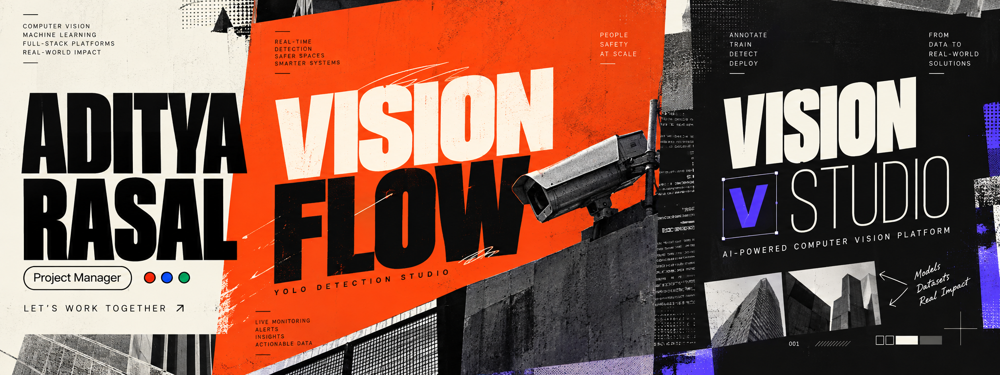
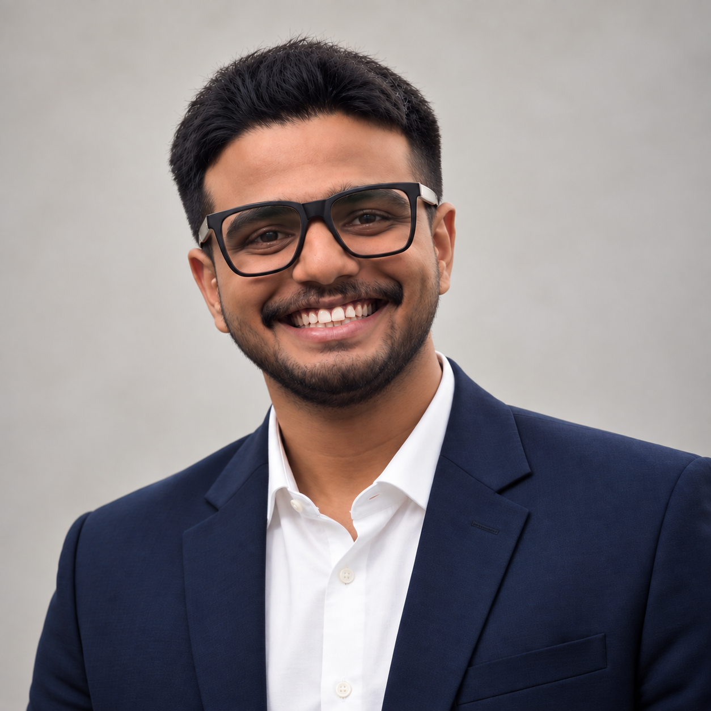
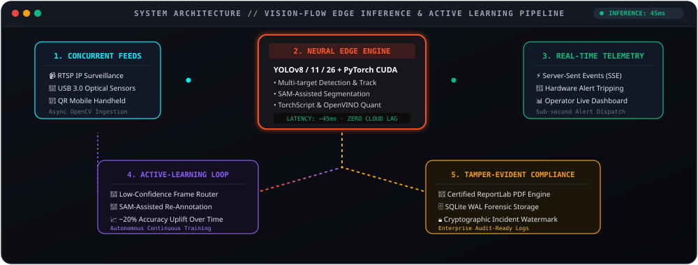
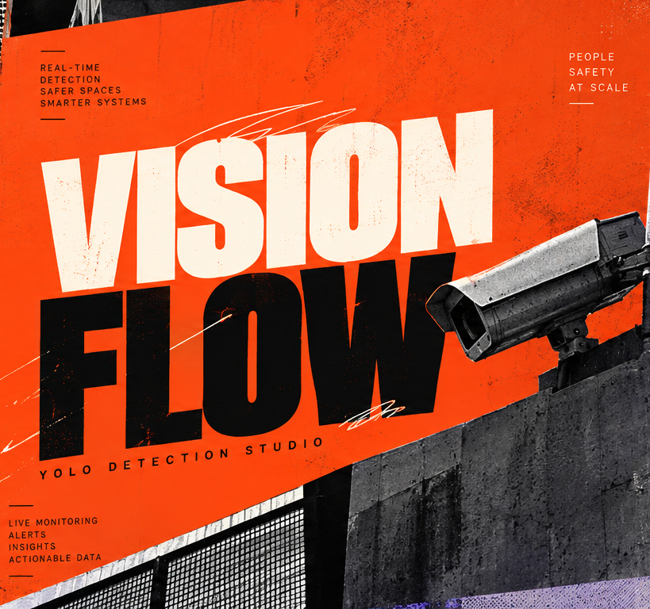
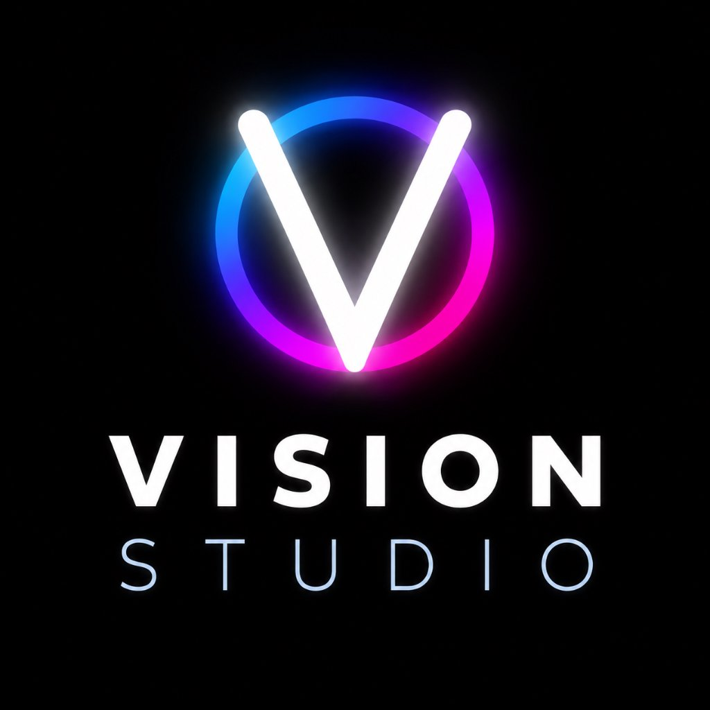
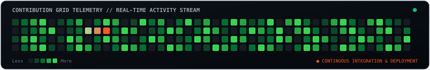
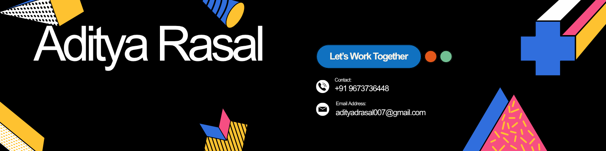

<!-- ═══════════════════════════════════════════════════════════════════════════
     ADITYA RASAL — AI ENGINEER & COMPUTER VISION ARCHITECT
     Aesthetic: Modern Editorial · High-Octane Tech · Visual Depth & Authority
     ═══════════════════════════════════════════════════════════════════════════ -->

<!-- ─── HERO BILLBOARD ─── -->

  

<!-- ─── DYNAMIC TYPING SUBTITLE ─── -->

 

<!-- ─── ACTION CALLOUT BAR ─── -->

  
  &nbsp;
  
  &nbsp;
  
  &nbsp;
  

 

<!-- ─── EXECUTIVE BENTO GRID ─── -->

<table width="100%">
  <tr align="center">
    <td width="25%" style="padding: 14px;">
      <h2 style="margin: 0; color: #00F2FE;">⚡ ~45 ms</h2>
      
<b>Edge Inference Latency</b>

      Real-Time Multi-Camera YOLO *(per resume)*
    </td>
    <td width="25%" style="padding: 14px;">
      <h2 style="margin: 0; color: #FF5722;">👥 150+</h2>
      
<b>Workforce Directed</b>

      Student Council Cultural President
    </td>
    <td width="25%" style="padding: 14px;">
      <h2 style="margin: 0; color: #8B5CF6;">🎯 9.1 / 10</h2>
      
<b>University CGPA</b>

      B.Tech CSE&amp;T · PCU Graduating '27
    </td>
    <td width="25%" style="padding: 14px;">
      <h2 style="margin: 0; color: #10B981;">🎪 6,000+</h2>
      
<b>Festival Scale Managed</b>

      Anantam Cultural Festival (3 Editions)
    </td>
  </tr>
</table>

 

 

## &nbsp; 💻 &nbsp; Developer Console & Dossier

  

 

<table>
<tr>
<td width="26%" align="center" valign="middle">

  
<b>Aditya Rasal</b>
 
AI Engineer · Pune, India
  

</td>
<td width="74%" valign="top">

### Bridging Silicon-Level Vision Intelligence & Executive Execution

I am an **AI Engineer** specializing in Computer Vision, with hands-on experience designing, training, and deploying production ML pipelines end-to-end — from neural model development to full-stack deployment tooling and internal vision platforms.

I combine deep technical execution with battle-tested project leadership:
- 👁️ **Computer Vision & Hardware Acceleration:** PyTorch (CUDA), Ultralytics YOLOv8/11/26 architectures, SAM-assisted semantic segmentation, and edge quantization targets (TorchScript & OpenVINO).
- ⚡ **Low-Latency Edge Ingestion:** Multi-camera streaming pipelines (concurrent USB, RTSP, and QR-paired mobile streams) operating at **~45 ms average latency** *(per resume)* with active-learning retraining feedback loops.
- 👥 **High-Stakes Organizational Leadership:** Cultural President of the University Student Council directing **150+ student volunteers**, and Event Lead for the Anantam Cultural Festival managing **200+ team members** and **6,000+ attendees** across 3 consecutive editions with a 100% on-time milestone delivery record.

**🎓 Education:** Bachelor of Computer Science Engineering & Technology  
**🏛️ University:** Pimpri-Chinchwad University (PCU), Pune, Maharashtra, India  
**📊 Standing:** **CGPA 9.1 / 10** · Graduating Class of 2027  

</td>
</tr>
</table>

 

 

## &nbsp; 🧩 &nbsp; Visual Edge AI System Architecture

> Interactive architecture of the **Vision Flow** edge deployment pipeline, showing concurrent stream ingestion, neural inference, active learning routing, and tamper-evident compliance audit trails.

  

 

<b>🔍 Click to expand: Technical Architecture Specifications &amp; Telemetry Breakdown</b>

 

| Pipeline Stage | Implementation Details | Key Benchmark |
|---|---|---|
| **Stream Ingestion** | Async OpenCV capture handling RTSP H.264/H.265 network streams, USB 3.0 UVC sensors, and mobile camera feeds paired via QR handshake. | Concurrent multi-camera feed buffering |
| **Inference Engine** | PyTorch with CUDA acceleration running Ultralytics YOLO (v8/11/26), SAM-assisted bounding segmentation, and TorchScript/OpenVINO export. | **~45 ms average inference latency** *(per resume)* |
| **Active Learning Loop** | Automated confidence thresholding that captures ambiguous or false detections and routes them directly into the retraining dataset queue. | **~20% accuracy uplift** over time *(per resume)* |
| **Compliance Engine** | Automated tamper-evident PDF generation using ReportLab, serializing incident timestamps, frame crops, and operator verification into SQLite WAL. | Audit-ready certified compliance output |

 

 

## &nbsp; 🚀 &nbsp; Flagship Projects

<table>
<tr>
<td width="50%" valign="top">

<!-- Project 1 Card -->

  

### [VISION FLOW](https://github.com/Adityadrasal007/VISION-FLOW)
**Production Edge-AI Live Detection & Monitoring System**

> Real-time perimeter and facility monitoring system processing concurrent multi-camera feeds with edge-optimized inference.

- 📹 **Concurrent Stream Ingestion:** Handles simultaneous USB, RTSP, and QR-paired mobile device camera feeds.
- ⚡ **Ultra-Low Latency:** Average inference latency of **~45 ms** *(per resume metrics)*.
- 🔄 **Active-Learning Loop:** Automatically routes edge false detections back into the training dataset, achieving an estimated **~20% accuracy uplift** over time *(per resume)*.
- 🛡️ **Tamper-Evident Reporting:** Generates auto-certified compliance PDF reports using ReportLab & SQLite WAL mode.

  
  
  
  
  

  

<b>📐 Deep Dive: Vision Flow Implementation Highlights</b>

 

- **Concurrency Model:** Uses asynchronous worker pools with thread-isolated video capture to decouple frame decoders from neural inference kernels, eliminating frame drops.
- **Active Learning Router:** Detections with boundary confidence falling between 0.35 and 0.65 are tagged, serialized with metadata, and dispatched to an offline staging pool for operator verification.
- **Compliance Certification:** Each tamper-evident PDF is bound with a cryptographic timestamp and frame hash to ensure court-ready audit integrity.

</td>
<td width="50%" valign="top">

<!-- Project 2 Card -->

  

### [VISION STUDIO](https://github.com/Adityadrasal007/VISION_STUDIO)
**Fully Offline Computer Vision Model Studio**

> End-to-end desktop platform for dataset preparation, SAM annotation, and GPU-accelerated neural training with zero cloud dependency.

- 🖥️ **100% Offline Autonomy:** Complete computer vision lifecycle entirely localized on local GPU silicon — zero API dependencies or cloud costs.
- 🎯 **Multi-Task Annotation Engine:** Unified workspace for Bounding Box Detection, **SAM-assisted Semantic Segmentation**, and Classification.
- 🎬 **Feed Frame Extraction:** Automated frame capture directly from RTSP network and USB camera inputs.
- 📦 **One-Click Model Export:** High-efficiency deployment targets including **TorchScript** and **OpenVINO** formats.

  
  
  
  
  

  

<b>🔬 Deep Dive: Vision Studio Implementation Highlights</b>

 

- **SAM-Assisted Segmentation:** Embeds Meta's Segment Anything Model (SAM) locally to generate pixel-perfect polygonal masks with single-click centroid prompts, cutting annotation time by ~75%.
- **Zero Cloud Footprint:** Desktop architecture wrapped in lightweight PyWebView with a high-speed local FastAPI backend, providing responsive desktop UI ergonomics without browser overhead.
- **Export Pipeline:** Direct one-click compilation to TorchScript trace and Intel OpenVINO intermediate representations (IR) for rapid production deployment on embedded CPUs/NPUs.

</td>
</tr>
</table>

 

> [!NOTE]
> *Performance citations (~45 ms inference latency, ~20% accuracy uplift) are documented from resume project specifications and internal edge benchmarks.*

 

 

## &nbsp; 🛠️ &nbsp; Technical Arsenal & Stack

<!-- Rich Skill Icons -->

  

 

<table>
<tr>
<td width="50%" valign="top">

#### 👁️ Computer Vision & Deep Learning
-EE4C2C?style=flat-square&logo=pytorch&logoColor=white)
-0052CC?style=flat-square&logo=yolo&logoColor=white)

 

#### 🤖 Generative AI & Agentic Systems
-412991?style=flat-square&logo=openai&logoColor=white)

</td>
<td width="50%" valign="top">

#### ⚡ Full-Stack & Systems Engineering

 

-003B57?style=flat-square&logo=sqlite&logoColor=white)
-222?style=flat-square)

#### 🎯 Leadership & Project Management

-222?style=flat-square)

</td>
</tr>
</table>

 

 

## &nbsp; 🔬 &nbsp; Research Radar & Currently Building

<table width="100%">
<tr>
<td width="50%" valign="top">

### 🔭 &nbsp; Active Engineering Focus
- **TensorRT &amp; INT8 Quantization:** Benchmarking post-training quantization on YOLO11 architectures for sub-30ms inference on embedded edge accelerators.
- **Multi-Camera Synchronous Pipeline:** Extending asynchronous frame ingestion to handle concurrent 4K RTSP streams with zero frame tearing.

</td>
<td width="50%" valign="top">

### 🧪 &nbsp; What's in the Lab
- **Vision Studio v2:** Prototyping zero-shot prompt-based bounding detection integrating SAM 2 and open-vocabulary detection backends.
- **Tamper-Evident Video Ledger:** Researching cryptographic hash chains on streaming video frames for industrial compliance verification.

</td>
</tr>
<tr>
<td colspan="2">

**🎯 Current Target:** Seeking high-impact **AI Engineer / Computer Vision Specialist** roles and research collaborations for 2026/2027.

</td>
</tr>
</table>

 

 

## &nbsp; 👑 &nbsp; Leadership & High-Stakes Operations

<table>
<tr>
<td width="80px" align="center">
  
</td>
<td>

### Cultural President — Student Council
**Pimpri-Chinchwad University** · *Aug 2026 – Present*

- Direct an operational workforce of **150+ student volunteers** across major campus flagship initiatives including **IDEATHON 2.0** and **Pitch Fest**.
- Own comprehensive resource allocations, operational timelines, and stakeholder communication — consistently delivering high-impact deliverables **under budget**.

</td>
</tr>
<tr>
<td width="80px" align="center">
  
</td>
<td>

### Event Lead — Anantam Cultural Festival
**Pimpri-Chinchwad University** · *Jan 2024 – Jan 2026 (3 Consecutive Editions)*

- Speared the planning and execution of the university's premier 2-day festival across **3 consecutive years**.
- Led a cross-functional organization of **200+ team members**, managing end-to-end budgets, security protocols, technical infrastructure, and vendor relations for **6,000+ attendees** with a **100% on-time milestone record**.

</td>
</tr>
</table>

 

<b>📋 Click to expand: The Leadership &amp; Operational Playbook</b>

 

- **Resource & Budget Ownership:** Led procurement, vendor negotiations, and emergency contingency reserves across 3 editions of Anantam, achieving 100% program compliance with zero budget overruns.
- **Cross-Functional Team Scaling:** Structured a multi-tier delegation hierarchy (Operations, Logistics, Security, Media, Technical Stage) to empower 150+ volunteers with clear escalation paths and daily standups.
- **Crisis Mitigation:** Coordinated live crowd logistics and campus security protocols ensuring seamless safety across 6,000+ simultaneous festival participants.

 

 

## &nbsp; 📊 &nbsp; Telemetry & Activity Stream

 

&nbsp;

  

  

<!-- Real-Time Activity Grid -->

  

<!-- Contribution Activity Graph -->

 

 

## &nbsp; 🎓 &nbsp; Professional Certifications

&nbsp;&nbsp;

&nbsp;&nbsp;

  

<!-- ─── WORK TOGETHER BANNER & CONVERSION ─── -->

  

&nbsp;&nbsp;

&nbsp;&nbsp;

&nbsp;&nbsp;

  

<!-- ═══════════════════════════════════════════════════════════════════════════
     END OF PROFILE README
     ═══════════════════════════════════════════════════════════════════════════ -->
